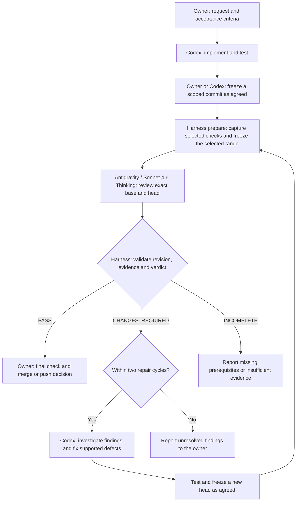

# Codex implementation / Antigravity review

Updated 2026-10-22. Codex is the implementation coordinator in the current chat. Antigravity is an independent reviewer invoked through its official `agy` CLI. The runner is dependency-free Node.js; it does not start a second Codex agent, install Git hooks, merge, push, or monitor the repository.

## Workflow at a glance



The current Codex chat coordinates this flow. The runner validates each review and enforces a maximum of three reviewer attempts per frozen run; the two-cycle repair limit is the coordinator's working agreement. Preparation/setup errors also stop the flow and must be reported.

An incomplete result requires an explicit recovery decision: retry after resolving an environment issue, or prepare a new run if source or review-copy integrity changed. Every code fix creates a new head and requires a fresh review. The owner retains the merge/push decision.

The Mermaid source above is the maintained diagram. Keep it consistent with the commands and outcome rules below when this workflow changes.

If the owner will commit manually, Codex can first copy all intended working files into an independent temporary repository, make a temporary candidate commit there, and use this same runner. Record hashes of every reviewed changed file and verify them against the owner's checkout afterward. Such a verdict applies to that temporary commit and matching file content. A later owner-created commit has a different identity; prepare a new run after that commit when an exact repository-HEAD verdict is required. Never commit or push in the owner's checkout against their instruction.

## Review scope and check selection

Record the feature's start commit before its first implementation. Select scope before each handoff:

| Review | Base and coverage | Context and evidence |
| --- | --- | --- |
| Routine increment | Previous successfully reviewed head of the same feature; use the feature start for its first increment | All changed files, directly affected dependencies/callers/contracts, relevant tests and check logs |
| Feature completion | Recorded feature start through the latest head | All feature changes, integration boundaries, failure/retry behavior, migration/compatibility impact and relevant tests |

Use the existing `--base` option for the range and task `context_files` for relevant unchanged tracked files. State the scope and acceptance criteria in the task goal/brief. All changed files in the selected range are included automatically; do not suppress them to save tokens. Changed code is supplied as full files, and changed Markdown normally as a diff. Unchanged dependencies/tests need explicit context or focused built-in file reading. A missing dependency or insufficient evidence requires more context or INCOMPLETE.

The coordinator chooses these scopes; there is no automatic mode switch or `--scope` flag. A routine PASS covers its exact range, not the entire feature. Feature completion needs the integration review even if every increment passed. A repair review should include the unresolved finding and its original context; do not hide it by advancing the base. Unrelated history and documents are not bundled by default. Splitting routine reviews preserves context capacity without truncating the feature-completion review.

Select required allowlisted checks by impact, not to obtain PASS. Run targeted tests during implementation; the runner's `app-tests` ID currently executes the full application suite. Use the app checks for changes affecting app behavior, data, API contracts or dependencies, and mobile exports/device checks when native acceptance requires them. The four-check `review-harness.json` brief remains the integration brief for this tooling feature, not a compulsory checklist for every later documentation edit.

For documentation/policy-only follow-ups, review document consistency and the affected harness behavior. The `review-scope-policy.json` brief uses the harness check; it does not rerun the unchanged mobile app. Earlier successful app checks remain evidence for their original revision and matching source. New `prepare` runs execute their own declared checks; the runner does not reuse prior logs as new results. Expand testing if code or its inputs/dependencies changed, a check failed, or evidence is insufficient.

The app's HTTP integration tests belong to its mobile evaluation backend. Only three test cases in `kibitz/tests/server.test.ts` bind temporary `127.0.0.1` ports; client/provider mocks do not. The four allowlisted checks do not start a web app or browser. Web previews, browser tests and web exports remain opt-in.

## One change cycle

1. Agree on a scoped task and observable acceptance criteria, select routine or feature-completion coverage as described above, and choose checks/context by impact. Create a JSON task under `harness/tasks/` using the example format. The task is reviewed context, not a place for arbitrary commands.
2. Codex implements and tests the change, then the owner or Codex creates a scoped local commit as agreed. Record the base before implementation. The task and reviewer policy must be committed with the change. All intended changes must be committed in the review source repository; dirty or unrelated files block preparation. Use the temporary-candidate procedure above for an owner-controlled pre-commit review.
3. Prepare the review from the **repository root**, using the intended base explicitly:

   ```sh
   node scripts/review.mjs prepare --base <base-commit> --task harness/tasks/<task>.json
   ```

   The command prints a unique `run_id`. It runs the required checks itself against the clean source HEAD and saves stdout, stderr, exit codes and the exact commit range. Checks run in the source checkout so installed mobile dependencies are available. The source must remain clean at the same HEAD throughout. Then it creates an independent clone with no remote and copies the evidence into it. It does not install dependencies or run checks against another revision.

4. Invoke the reviewer:

   ```sh
   node scripts/review.mjs run --run <run_id>
   ```

   Codex reads the JSON output and `harness/runs/<run_id>/report.md` / `result.json` in this chat. No manual copying between apps is required when the CLI is ready. A repeated command returns the cached result; `--retry` explicitly makes another request after an environment failure. At most three reviewer requests are allowed per frozen run.

5. Codex investigates each finding, fixes supported issues, reruns affected checks and freezes the fixes as agreed with the owner. Prepare a **new run for the new HEAD**, preserving the finding's context and keeping the feature-start base for feature-completion coverage. Limit implementation/review repair cycles to two under the coordinator's instructions, then report unresolved findings to the owner. This cycle limit is a working agreement; the runner's per-run request ceiling is enforced in code.
6. The owner decides whether to merge/push. A local `PASS` is review evidence, not GitHub branch protection or proof of native/model quality.

## Setup and diagnostics

```sh
node scripts/review.mjs doctor
node --test scripts/review.test.mjs
```

`doctor` makes no model request. It checks Git, the reviewer flags, and optionally Codex CLI. It does not claim authentication is working. `codex` CLI is optional because the current chat already coordinates implementation.

### Reviewer model policy

`harness/reviewer.json` pins `claude-sonnet-4-6` (Claude Sonnet 4.6 Thinking). The owner explicitly changed the default from Opus on 2026-10-22 after a quota-interrupted review. This is a policy change, not an automatic fallback. `prepare` reads the policy from the exact reviewed HEAD, and `run` explicitly passes `--model`. No separate effort override is sent. Confirm account availability with `agy models` when setting up or changing this policy; the signed-in account listed this model on 2026-10-22. A missing model, unsupported flag or exhausted allowance requires recovery or an explicit owner decision. Earlier Opus PASS/INCOMPLETE records keep their original model and outcome.

The runner uses `stream-json`, validates the `init.model` selection and final structured result, and records `requested_model` and `reported_model` in `result.json`. Raw events remain in `attempt-NN/stdout.jsonl`. A missing/mismatched model cannot PASS. The CLI does not attest server-side execution. Saved status revalidates the verdict and model provenance against the raw stream. Older reviews without this provenance cannot serve as pinned-model reviews.

Install the official Antigravity CLI from Google's [quickstart](https://www.antigravity.google/docs/getting-started). The standard executable location `~/.local/bin/agy` is discovered even when absent from `PATH`. Complete sign-in in an interactive `agy` session if a headless review reports authentication required. The runner never opens a browser or changes authentication/permission settings.

Executable overrides are single paths, never shell fragments:

- `KIBITZ_AGY_BIN`: the official `agy` executable.
- `KIBITZ_GIT_BIN`: a working Git executable if the OS Git needs Xcode setup. The harness never accepts OS licenses.
- `KIBITZ_CODEX_BIN`: optional Codex CLI path for diagnostics.

### Process input and environment

The runner sends one NDJSON `user` message through stdin using `--input-format stream-json`, then closes input. The CLI completes that turn before exiting. Prompts and source/check context are never passed through `-p`, `--print` or `--prompt`, so they do not appear in the reviewer process command line. Stdin delivery errors fail the review; the existing timeout, output bound and result/model validation still apply.

`reviewerEnvironment` in `scripts/review.mjs` is the explicit environment allowlist for reviewer runs and CLI help probes. It retains runtime/search paths, home/config/cache and supported credential-file locations, temporary directories, locale/terminal settings, proxies and CA certificate paths. It drops unknown variables, application/provider API keys, beta access codes, GitHub/AWS tokens, `NODE_OPTIONS` and shell preload settings. The runner uses the parent's executable overrides to locate tools, but does not forward those override variables to the reviewer.

Cached interactive sign-in is the normal authentication path. API keys exported for the application are deliberately not a reviewer authentication path. Required proxy/credential-file settings are intentionally preserved; this is least-privilege environment handling, not protection against a compromised CLI or host. No global permission or authentication settings are changed.

Git commands and required repository checks retain their existing execution environment. Preparation runs owner-trusted repository scripts outside the review CLI sandbox; an allowlisted check ID does not make hostile third-party test/package scripts safe. Their isolation would require a separate execution environment.

The reviewer is invoked with `--sandbox --disable-slash-commands`, a bounded `--print-timeout`, the pinned model policy, and structured NDJSON output. A bounded 120 KB bundle supplies full changed code, test context and actual check logs; changed Markdown is supplied as a diff. Harness tests are included when required. Add optional `context_files` (repository-relative tracked paths) for relevant unchanged application tests or dependencies; running app checks does not automatically bundle the entire unchanged app test suite. Oversized context is INCOMPLETE before any model request. The reviewer is instructed to use supplied evidence or built-in file-reading tools, with no terminal commands required. It does not bypass permission prompts or modify global permissions. Headless tools that cannot obtain permission can be denied even when the process exits zero; denied-tool diagnostics or a nonempty `denied_actions` envelope invalidate the result. Fix only the specific required environment permission, or use manual review with an explicit incomplete automation status.

## Trusted checks and verdicts

Task `checks` contains only these IDs:

| ID          | Command and directory                         |
| ----------- | --------------------------------------------- |
| `harness`   | `node --test scripts/review.test.mjs`, root   |
| `typecheck` | `npm run typecheck`, inner `kibitz/`          |
| `lint`      | `npm run lint -- --no-cache`, inner `kibitz/` |
| `app-tests` | `npm test`, inner `kibitz/`                   |

Checks use real exit codes; the reviewer cannot declare a failed check passed. The test suite uses provider doubles and makes no model request. A real review uses the signed-in Antigravity account and its usage allowance.

| Outcome / exit           | Meaning                                                                                                                                                 |
| ------------------------ | ------------------------------------------------------------------------------------------------------------------------------------------------------- |
| `PASS` / `0`             | Exact base/head; matching pinned-model evidence; complete acceptance evidence; all required checks succeeded; no findings; unchanged review copy/source |
| `CHANGES_REQUIRED` / `2` | Valid review identifies defects/unmet criteria, or a required executed check failed                                                                     |
| `INCOMPLETE` / `3`       | Missing tools/authentication, timed out/denied execution, invalid output, unverified criteria or insufficient/mismatched evidence                       |
| Usage/setup error / `1`  | Invalid arguments, dirty source, concurrent run, failed preparation or exceeded request ceiling                                                         |

CLI execution `status: SUCCESS` only says the CLI returned an answer. The runner separately validates `structured_output` against `review.schema.json`, commit IDs, one result for every acceptance criterion, cited tracked files and line bounds, and actual check results. A schema-valid review still needs human judgment about its reasoning and coverage.

Recheck a saved result before using it:

```sh
node scripts/review.mjs status --run <run_id>
```

A changed source HEAD, uncommitted source, or altered snapshot invalidates prior evidence. Trust the validated status, not an old copied `PASS` string. A process crash may leave `running.lock`; inspect whether a reviewer is still running before manually removing that lock. Never delete an active lock to launch a second request.

## Isolation and evidence limits

The review copy uses independent Git objects, has its GitHub/local origin removed, and contains committed files only. Ignored environment files and the developer's installed dependencies are not copied. Do not commit credentials or personal journal data to a task or fixture.

The runner hashes snapshot paths, contents, modes and symlink targets before/after review and checks source cleanliness. It detects edits rather than claiming the prompt makes files read-only. The official CLI sandbox provides its configured OS boundary; this runner is not a container or protection against a compromised host/CLI. Tests run in the source checkout are recorded as harness-executed evidence, not falsely described as reviewer-executed tests.

All runtime artifacts are private local files under ignored `harness/runs/`: task/check context, snapshot, raw CLI responses, diagnostics and validated results. They can contain source snippets. Review/remove them deliberately when no longer needed; never commit the whole run directory.

## Current execution model

This first version is invoked by Codex following `AGENTS.md`. It has no always-on daemon, editor event listener or unattended implementation loop. Authentication remains an environment prerequisite. A later standalone coordinator could invoke `codex exec`; that is a separate extension and is not needed to use this chat's review workflow.

References: [Antigravity headless mode](https://www.antigravity.google/docs/cli/headless/) and [OpenAI non-interactive mode](https://learn.chatgpt.com/docs/non-interactive-mode). Installed CLI help is also checked by `doctor`; unsupported flags are not silently replaced.
