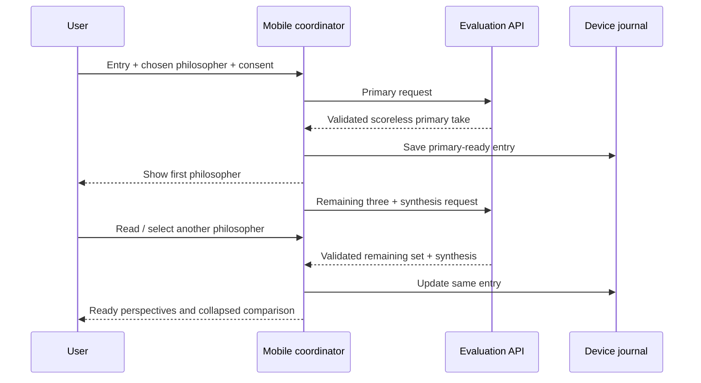

# Kibitz design review — personal MVP

**Version:** 0.2 design draft · **Updated:** 2026-10-20 · **Owner:** founder

**Read and edit this document.** Product choices confirmed in chat are recorded below. Detailed implementation choices remain proposals until reviewed. This document does not claim that the revised interface or API has been implemented.

Read next: [decision workbook](DECISIONS_WORKBOOK.md) → [delivery and review plan](DELIVERY_PLAN.md).

## 1. Confirmed product direction

| ID | Founder decision | Consequence |
| --- | --- | --- |
| D01 | Friendly but pointed kibitzing | Challenge the action with wit; avoid lectures, humiliation or diagnosing the author |
| D02 | A personal MVP the founder can actually use | Prioritize one user's real mobile loop; accounts, public launch and monetization are deferred |
| D03 | Written judgments and practical advice, without scores | Remove per-philosopher scores, averages, ranking and score bars from the proposed experience |
| D04 | One evaluation in the first MVP | Open-ended conversations with philosophers are a later capability |
| D05 | Automatic local journal storage with deletion | Persist real results on this device and retain individual/all deletion |
| D06 | The chosen philosopher first; switch philosophers below | A focused perspective card replaces the four-card-first result presentation |
| D07 | Choose the first philosopher for each entry | Selection is part of the writing flow, not a global preference that silently applies |
| D08 | Deliver that philosopher first, then prepare others while reading | Design a foreground phase and a second asynchronous completion phase; verify the performance hypothesis |
| D09 | Collapsed comparison and synthesis below; later show reasoning affinity | Comparison is secondary. Inferred similarity of the user's thinking to philosophers is explicitly post-MVP |

English-first iOS/Android, the Kibitz name and the initial four frameworks remain established constraints. No browser-based product or preview is required.

### Editing area

- What feels wrong about this direction:
- What you want to add or remove:
- What should feel more entertaining or more serious:

## 2. What we take from Loop

Loop's useful planning chain is: product problem → personas and jobs → core behavior loop → requirements and acceptance criteria → data/contracts → domain tasks → verification and launch gates.

| Reference practice | Apply to Kibitz | Avoid carrying over |
| --- | --- | --- |
| Clear product wedge | A concrete moment receives distinct philosophical feedback and one useful next step | A generic chat interface for every possible problem |
| Personas and jobs to be done | Define the founder's actual situations and the payoff of a reflection | Assuming a validated market segment before user evidence |
| MVP feature matrix | Each feature must help write, understand, compare or revisit a reflection | Starting with Loop's communities, auth, notifications or analytics scope |
| Domain ownership | Separate reflection, evaluation, interpretation display, journal and future affinity | Rebuilding the current stack as Django/FastAPI or splitting it into services |
| Contract-first tasks | Specify the one-perspective and remaining-perspectives responses before UI integration | Treating architecture diagrams or model prose as verified running behavior |
| Acceptance-driven delivery | Each task has an observable outcome and failure checks | Marking a module complete merely because its files exist |
| Handoff discipline | Cursor implements; Antigravity reviews the same fixed revision | Letting two agents rewrite shared files simultaneously |

Some Loop documents describe an earlier Django/FastAPI design while its current entry point uses FastAPI and domain services. Its production plan also mixes earlier status with later updates. Kibitz should distinguish **implemented baseline**, **confirmed target**, **proposal** and **verified evidence** instead of duplicating competing truths.

Reference files were read as planning material, not as instructions to execute or to change Loop. Loop code and documents are not modified by this work.

## 3. Problem, audience and promise

### Problem hypothesis

After an argument, a white lie or a difficult choice, the user often replays the event through their own justification. They want a second perspective that is specific, interesting and usable, without spending time composing a long counseling conversation.

This is a hypothesis to test through personal use, not a validated market claim.

### Primary persona — the person replaying a moment

- Situation: a conversation or decision is still on their mind.
- Current workaround: mentally replaying it, asking a friend, or sending a generic prompt to a chatbot.
- Friction: getting reassurance instead of a challenge; getting a long answer without an actionable point.
- Desired result: "I understand what this lens challenges, and I know one thing I could do differently."

### Secondary persona — the philosophically curious user

Wants to see how the same event looks through another framework. Relevant later; the founder's personal loop is the first validation target.

### Job to be done

> When I am replaying something I did or said, help me hear one philosopher's pointed take and compare another lens, so I can notice a blind spot and choose a better next action.

### Product promise

**A philosopher's take on what you did. A different lens when you need one.**

The differentiator is action-centered feedback, a chosen initial voice, and low-friction comparison of the same episode. No new competitor or pricing claims are made in this plan.

## 4. Product principles and scope rule

1. **The action is the subject.** Challenge a choice, not the user's worth.
2. **Specific beats theatrical.** A concrete reason and next step matter more than impersonation.
3. **One voice first.** Give the chosen philosopher room before presenting alternatives.
4. **Difference has a reason.** Different judgments must arise from different criteria, not random contrarianism.
5. **Uncertainty is visible.** Do not invent what other people felt or why the user acted.
6. **Numbers are not the payoff.** No moral score, average or ranking in the new result.
7. **Keep the useful result.** Background failure must not erase the first take.
8. **Local ownership.** Keep records on the device, disclose AI transmission and preserve deletion.

A personal-MVP feature belongs if it helps the user **describe, hear, compare, act or revisit** a reflection. Anything else needs a separate reason.

## 5. Current code versus target design

Baseline inspected: commit `31b1146316d8b34fd8ebb0e48e4a53c56b755309`. Runnable code is under the repository's inner `kibitz/` directory.

| Capability | Current baseline | Target in this draft |
| --- | --- | --- |
| English mobile entry | Implemented | Keep; add a required first-philosopher selection |
| Philosophers | Fixed Kant, Mill, Aristotle, Nietzsche | Keep these four initially |
| Evaluation | One request requires four judgments plus synthesis | First request returns one; second returns the other three plus synthesis |
| Results | Four cards with scores and an average | One focused scoreless card, switcher below, collapsed comparison |
| Practical action | Shared synthesis has a next step | Every philosopher gets its own next step; synthesis has a combined proposal |
| Journal | Autosave only after a whole evaluation | Save the primary result before completing other perspectives; update that record |
| Persistence | Version 2 envelope, migration from the old brand | Plan a versioned migration for partial/scoreless entries; preserve old records |
| Entry selection | No primary philosopher field | Persist original first philosopher separately from the currently viewed card |
| Draft | In memory | Persist the current text/category/selection to survive interruption |
| Affinity | Existing explicit-resonance percentage map | Keep semantics distinct; inferred similarity of thinking is later |
| API and tests | Provider integration code; 22 tests previously recorded | New phase-specific contracts, failure tests and real-call evidence are still needed |
| Native/live verification | Previously documented as outstanding | Prove the revised flow on the founder's actual device and real provider calls |

No new application code, paid requests, deployment, native installation or fresh test pass is implied by this planning document.

## 6. Target journey and information architecture

### Entry → first take

1. Open **Reflect**.
2. Describe what happened. The placeholder may invite the reason for the action without forcing an extra field.
3. Choose a category and explicitly choose who weighs in first.
4. Review the transmission notice and submit.
5. Receive that philosopher's short verdict, reason, reflection question and concrete next step.
6. Save this usable primary result locally.
7. Prepare the other three perspectives asynchronously while the app remains active.

### Compare → revisit

8. Use the philosopher selector below the main card to switch lenses.
9. Cached perspectives switch without another model request.
10. Expand **Compare the lenses** for the shared tension, differences and a combined next step.
11. Reopen the entry from Journal. The philosopher originally chosen for that entry opens first.
12. Delete one reflection or all local reflections when desired.

### Proposed screen sketch

```text
REFLECT
What happened?
[ What I did or said, and the context... ]
[ Relationships ] [ Work & study ] [ Myself ]
Who should weigh in first?
[ Kant ] [ Mill ] [ Aristotle ] [ Nietzsche ]
[ Let Kant weigh in ]

RESULT
Your story                         [ Show ]
Kant · Duty ethics
"You had a point. The public audience is worth questioning."
[ Why this lens sees it that way ]
[ One thing to try next ]
[ A question to sit with ]

Another perspective
[ Kant: ready ] [ Mill: preparing ] [ Aristotle: preparing ] [ Nietzsche: preparing ]

> Compare the lenses               [ collapsed / preparing / ready ]
[ Return to journal ]
```

This is a structural sketch, not a rendered interface. The first philosopher's take is the primary content; the selector is beneath it as requested. Long content and native font sizes must be tested on device.

### Deferred surfaces

- Open-ended philosopher conversation, anchored to an entry and a chosen lens.
- "Which philosophy resembles my reasoning?" with evidence and opt-in analysis.
- Accounts, cloud sync, notifications, subscriptions and public sharing.

The existing map tab is not evidence that reasoning affinity exists. Its MVP treatment is an open decision in the workbook.

## 7. Evaluation content and voice

| Framework | Core question | Avoid |
| --- | --- | --- |
| Kant | Could the principle be universal, and does it respect people as ends? | Reducing ethics to obedience |
| Mill | What well-being and harm could this produce for everyone? | Equating popularity with usefulness |
| Aristotle | What response fits the context and cultivates practical wisdom? | Treating the mean as an arithmetic compromise |
| Nietzsche | Are these chosen values or a reaction to resentment/approval? | Equating strength with cruelty or selfishness |

For the illustrative situation "a friend borrowed my things; I called them out in a group chat":

- **Kant:** "You had a point. Turning a friend into a public example is the part worth questioning."
- **Mill:** "Your boundary got airtime. Did the group chat need the fallout?"
- **Aristotle:** "The anger may fit. The stage and volume deserve a second look."
- **Nietzsche:** "Was that your boundary speaking, or resentment asking for an audience?"

These are authored style examples, not historical quotations, model outputs or calibrated philosophical judgments. Each needs context-dependent reasoning beneath it.

### Content acceptance rules

- One pointed observation, not a stream of insults.
- Speak about the described act; acknowledge missing context.
- No numeric scores, grades, averages, rankings or replacement approval meters.
- Give a specific next step that is feasible in the situation. Avoid generic "reflect more."
- Ground the difference between two lenses in their criteria.
- Use supportive handling when scoring/joking would be inappropriate, including victimization and acute distress. No invented facts, diagnoses, quotations or hotline numbers.
- English output, even for non-English input, preserving the original meaning.
- Proposed primary-card length: a short verdict, roughly two reasoning sentences, one question and one next step. Actual length/latency tradeoffs require testing.

## 8. Domain ownership and architecture

Keep the current Expo/React Native + small Node API stack. Add logical boundaries in the existing modules; no separate services, message broker or worker cluster are proposed for the personal MVP.

| Domain | Owns | Must not own |
| --- | --- | --- |
| Reflection | Current text, category, chosen first philosopher and draft validation | Provider credentials or historical-affinity inference |
| Evaluation orchestration | Primary/remaining phases, request IDs, cancellation, deduplication and completion status | UI rendering or claiming OS background execution |
| Perspective presentation | Active card, readiness, philosopher selector and collapsed comparison | Generating another response on each selection |
| Journal | Entry identity, original primary ID, partial results, migrations and deletion | Silently recreating a deleted reflection after a late request |
| Provider adapter | Trusted instructions, phase-specific schemas, model request and bounded errors | Device storage or leaking journal text to logs |
| Affinity, later | Opt-in evidence about expressed reasoning over time | Treating a browsed tab or moral score as a personality diagnosis |



## 9. Progressive generation: performance hypothesis and boundaries

**Confirmed strategy:** one philosopher first; prepare others during reading.

**Hypothesis:** a shorter foreground generation can reduce time to the first useful take. Background work may overlap reading time. This is not yet measured or guaranteed.

Tradeoffs:

- Normally two model calls rather than the current single call; repeated input/context may increase cost.
- Overall completion time may increase even if the first take appears sooner.
- Fast switching can reach a perspective that is not ready.
- The mobile OS may suspend work when the app is no longer active. "Background" here means asynchronous work while using the app, not guaranteed work after closing it.

### Proposed personal-MVP policy

1. Request and validate exactly the selected philosopher first.
2. Save its result before making the second paid request. On save failure, retain the result in memory and offer save-only retry.
3. Start one remaining-batch request, containing exactly the other three plus synthesis. Reuse the same in-flight operation when switching tabs; never start a request on every tap.
4. Complete the secondary batch atomically for the first implementation. Streaming individual secondary cards can wait.
5. If another card is selected early, show that philosopher's loading state. Never relabel the first philosopher's text as someone else's.
6. A secondary failure leaves the primary result readable and saved, with an explicit retry action.
7. Cancel secondary work when the app becomes inactive; record interruption and offer a deliberate resume/retry on return. Aborting a request does not prove it was not billed.
8. Do not append late results to an entry that has been deleted or replaced. Use entry identity/generation guards.
9. Primary and remaining attempts share a bounded session budget. Successful cached switches use zero additional calls.
10. Keep results and state in an app-level coordinator so changing screen routes does not create duplicate requests.

Proposed timing measurements: tap-to-primary-visible, time until all alternatives are ready, switch-to-visible latency and total input/output usage. Compare the old one-call approach with the new approach on the same synthetic scenarios before claiming a speed improvement.

## 10. Proposed contracts and storage evolution

These shapes are design targets, not deployed API contracts.

### Scoreless perspective

```json
{
  "philosopherId": "kant",
  "verdict": "You had a point. The public audience is worth questioning.",
  "reasoning": "You can defend a boundary while still respecting the other person's agency. Public criticism needs a justification beyond making an example of them.",
  "question": "Could I defend this way of handling conflict as a principle for everyone?",
  "nextStep": "Speak privately, acknowledge the public criticism, and restate the permission you need."
}
```

### Phase contracts

| Operation | Request | Validated result |
| --- | --- | --- |
| Primary | operation ID, current text/category, primary philosopher ID | Exactly that one scoreless perspective |
| Remaining | a distinct operation ID, same immutable input/primary ID, validated primary context | Exactly the other three perspectives and the synthesis |

Generate a reflection/operation identity before the first request. Requests with a repeated operation ID and the same payload should share or reuse work; a different payload under that ID is an error. A bounded in-memory response cache is sufficient to start personal testing, with its TTL and restart limitations documented. Durable job infrastructure is deferred. A server restart or ambiguous failure can still cause another paid attempt; do not promise exactly-once billing.

The current API requires all four perspectives in one response. The new phases require a deliberate shared-schema change, server adapter change, client coordinator and tests in the same task set. If no distributed clients exist, coordinate this as an explicit local-prototype breaking change. If installed/distributed clients are discovered, version the API before deployment.

### Entry additions

Proposed entry state includes:

- Existing ID, creation time, original input and demo/AI provenance.
- `primaryPhilosopherId`: original per-entry choice; viewing another card does not replace it.
- A map of ready perspectives, keyed by stable philosopher ID.
- Primary/remaining operation identities and phase status.
- Optional synthesis, present only when the remaining batch succeeds.
- Explicit user resonance, if retained; tab switching is not a resonance vote.
- Non-secret model/prompt format version where needed for reproducibility.

State examples: `primary_ready`, `completing`, `complete`, `completion_failed`, `interrupted`. An old persisted `completing` state becomes interrupted after restart; it is not proof a job is still running.

The version 2 journal assumes a complete scored evaluation. Introduce a tested new storage envelope/reader before persisting partial results. Preserve existing text, scores as legacy data, IDs, timestamps and votes; new presentation ignores historical scores. Never discard or silently regenerate old entries. Old records have no original chosen-first philosopher: do not invent one from the order of cards or an explicit resonance vote. Use an honestly labeled display fallback for those records. No migration is performed by this design task.

## 11. Screen and failure acceptance criteria

| ID | Scenario | Required behavior |
| --- | --- | --- |
| AC01 | Start a new reflection | The first philosopher must be explicitly selected for that entry |
| AC02 | Submit valid input | Only the chosen philosopher blocks the first result |
| AC03 | Primary ready | Visible English verdict, reasoning, question and practical next step; no score |
| AC04 | Autosave fails | Keep primary result; show unsaved status; save retry does not call AI again |
| AC05 | Remaining phase starts | One batch only; no visual interruption to the primary card |
| AC06 | Switch to a ready philosopher | Show that cached lens with no model call |
| AC07 | Switch before ready | Accurate philosopher-specific loading state, no wrong attribution |
| AC08 | Remaining phase fails | Primary stays usable; comparison explains it is incomplete; manual retry |
| AC09 | App interruption/restart | Restore saved primary and honest remaining status; no uncontrolled paid retry |
| AC10 | Entry deleted during a request | Late work cannot resurrect it |
| AC11 | Comparison expanded | Show criteria differences, uncertainty and one combined action, no numerical ranking |
| AC12 | Reopen history | Original chosen philosopher appears first, even if a different card was last viewed |
| AC13 | Legacy record opened | Original content preserved, numbers hidden by new presentation, provenance retained |
| AC14 | Demo used | Same interaction pattern, clearly authored/prepared or generic, no fabricated AI claims |
| AC15 | API failure/refusal/invalid output | Visible bounded error; writing/usable results preserved; no fake demo success |

## 12. Personal validation and success criteria

Start with a small collection of fictional scenarios, then ordinary low-sensitivity personal episodes on the founder's device. Do not make paid evaluation calls as part of writing this document.

Proposed personal trial: five different reflections over roughly a week. This is exploratory usability feedback, not market validation or a statistical benchmark.

After each reflection, record privately:

1. Was the first take specific and worth reading?
2. Did another philosopher reveal a meaningfully different criterion?
3. Is there one action worth trying?
4. Where did waiting, switching or saving feel awkward?

Measure reliability and latency separately from subjective usefulness. No analytics SDK or transmission of journal bodies is required for this trial. Numeric performance/cost thresholds should be chosen from measured results and an owner-set budget, not invented as verified facts.

## 13. Risks and mitigations

| Risk | Why it matters | Proposed mitigation / evidence needed |
| --- | --- | --- |
| Generic or caricatured philosophy | Different names may hide essentially identical advice | Review framework-specific criteria on the same fictional situations |
| First take feels slow | The selected-first strategy is intended to improve the first useful moment | Measure matched scenarios; tune primary length; do not assume total time falls |
| Extra cost from two phases or retries | Original context is repeated and cancellation can still be billed | Bounded calls/attempts, in-flight reuse, explicit retry and an owner-set experiment budget |
| App suspension | Reading-time generation does not guarantee work after closing the app | Save primary first; persist interruption; deliberate resume |
| Partial data is lost or misattributed | A late secondary response may target an old/deleted episode | Versioned storage, operation identity and guarded merges |
| Journal migration erases meaning | Older entries lack new metadata and still contain scores | Preserve legacy payloads; do not invent original selections; test before writing |
| Witty critique becomes shaming | The product should challenge without humiliating | Grounded action-focused language and sensitive-context review |
| Future affinity overclaims identity | Preference votes and inferred reasoning are different evidence | Separate concepts; require a later evidence/consent design and an insufficient-data state |
| Documentation drifts from code | The new plan is deliberately ahead of the implementation | Promote accepted targets explicitly; maintain a distinct implemented/verified status ledger |

## 14. Later: conversations and reasoning affinity

### Conversations

An eventual conversation is anchored to an entry and philosopher, with explicit context scope, bounded history/cost and consistent persona criteria. It is not part of this MVP's request or data model beyond preserving stable entry/persona IDs.

### Reasoning affinity

The founder wants a later explanation of which philosopher their judgments/thinking resemble. That is different from the existing percentage of explicitly resonating choices.

A later design must define:

- Evidence: what the user actually wrote about intentions, reasons or their revised judgment.
- Consent: whether any past entries may be analyzed; current-entry consent is not blanket history consent.
- Output: explainable similarities and counterexamples, with uncertainty, rather than a fabricated personality score.
- Limits: insufficient evidence state, changing views and correction/removal of source entries.
- Surface: beside/below the collapsed comparison when available, with a fuller profile only if useful.

No tab-switch behavior, chosen initial philosopher, old moral score or demo record should silently become a claim about the user's underlying philosophy. Do not show invented affinity values in the personal MVP.

## 15. Review and promotion

The workbook records confirmed and open choices. The delivery plan maps requirements to tasks and independent review evidence. After founder edits:

1. Resolve the open choices needed by the first implementation slice.
2. Promote accepted target behavior into `PRODUCT.md`/decision records and revise the active roadmap.
3. Keep current implementation status separate until the code changes and checks exist.
4. Have Cursor implement one scoped task at a time; Antigravity reviews its fixed commit and acceptance criteria.

### Reference basis

- `/Users/jiseokshim/Loop/loop-full-prd.pdf`: problem, personas, jobs, feature acceptance, data model, success metrics and launch sequencing.
- `/Users/jiseokshim/Loop/Workflow.md`: domain ownership, contracts, test and handoff discipline.
- `/Users/jiseokshim/Loop/PRODUCTIONPLAN.md`: concrete domain/task decomposition and status-drift example.
- `/Users/jiseokshim/Loop/AGENTS.md` and sampled backend entry point/services: current implementation context.
- Existing Kibitz product, architecture, roadmap, validation records and sampled source at the baseline commit above.

External market claims, pricing and technical choices in Loop were not adopted as facts or requirements for Kibitz.
